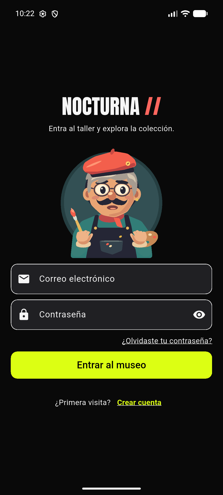
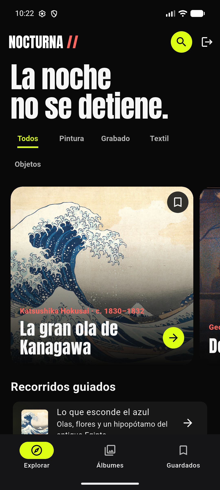
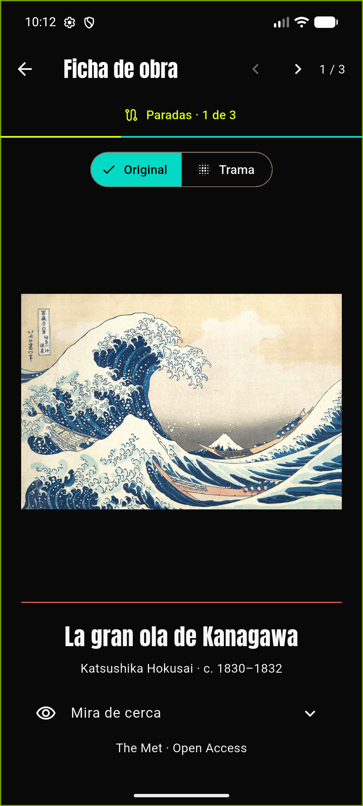
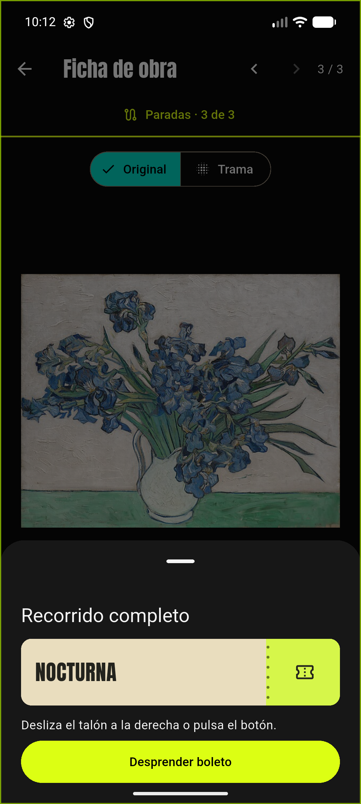

# Nocturna · Hito 1

Nocturna es una galería de arte en Flutter con inicio de sesión mediante Firebase Auth y un catálogo servido por Spring Boot. El recorrido empieza con un pintor interactivo en Rive y continúa con doce obras de [The Met Open Access](https://www.metmuseum.org/hubs/open-access).

## Capturas en Android

| Inicio de sesión | Explorar |
| :---: | :---: |
|  |  |

| Ficha del recorrido | Boleto de visita |
| :---: | :---: |
|  |  |

## Ejecutar la demo

Necesitas Flutter, Dart 3.13.4 o compatible, Java 21, Maven y Node.js. Para Android también necesitas un dispositivo virtual configurado en Android Studio. Si preparas Firebase desde cero, coloca el archivo de tu proyecto Android en `android/app/google-services.json` en tu copia local.

Desde la raíz del repositorio, instala las dependencias de Flutter y compila la API.

```sh
flutter pub get
mvn -f museum-backend/pom.xml verify
```

En dos terminales abiertas en `museum-backend/`, inicia la API y el emulador de autenticación.

```sh
java -jar target/museum-backend-0.1.0.jar
```

```sh
npx firebase-tools emulators:start --only auth --project demo-museo-nocturno
```

Con el emulador Android abierto, ejecuta desde la raíz:

```sh
flutter devices
flutter run -d emulator-5554 -t lib/museum_main.dart --dart-define=MUSEUM_AUTH_EMULATOR=true
```

Usa el identificador que muestre `flutter devices` si es distinto. El emulador Android llega al backend por `10.0.2.2:8091` y a Firebase Auth Emulator por `10.0.2.2:9099`.

Para probar en Chrome:

```sh
flutter run -d chrome --web-hostname localhost --web-port 7357 -t lib/museum_main.dart --dart-define=MUSEUM_AUTH_EMULATOR=true
```

Crea una cuenta de prueba desde **Crear cuenta**. El registro requiere un correo `@tecdesoftware.edu.mx` y una contraseña de al menos ocho caracteres con mayúscula, minúscula, número y símbolo. Las cuentas de prueba se pierden al detener el emulador, salvo que se exporten e importen sus datos.

## Qué mostrar

1. **Identidad.** Prueba el registro y el acceso. El pintor sigue el correo con la mirada, se cubre los ojos al enfocar la contraseña y reacciona al resultado.
2. **Conexión.** La aplicación consulta `GET /api/artworks` en Spring Boot. Cada ficha incluye la URL pública HTTPS de The Met y la ruta de una copia incluida en Flutter como respaldo.
3. **Recorrido.** Abre **Explorar → Recorridos guiados → Lo que esconde el azul**. Desliza la portada, inicia la visita y toca **Paradas** para navegar. Tras visitar todas las obras, recoge el boleto. Los boletos y las obras guardadas pertenecen a la sesión. Los álbumes se guardan en H2.
4. **Detalle.** Activa **Trama** y arrastra sobre la imagen para revelar su color. El patrón está inspirado en [Halftone Reveal](https://www.reactbits.dev/animations/halftone-reveal).

Para ejecutar las pruebas de Flutter, corre `flutter test` desde la raíz.

La API de la demo corre en local y sus álbumes se comparten entre las sesiones de la demo. Consulta la [configuración del backend y de la compilación web](museum-backend/README.md) o la [fuente de la animación del pintor](design/nocturna-painter/README.md).
